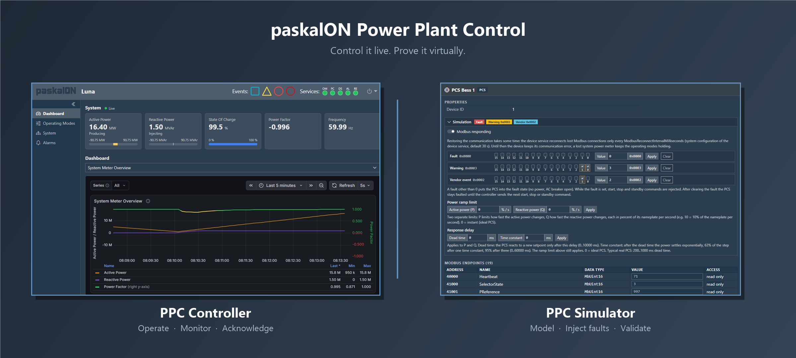
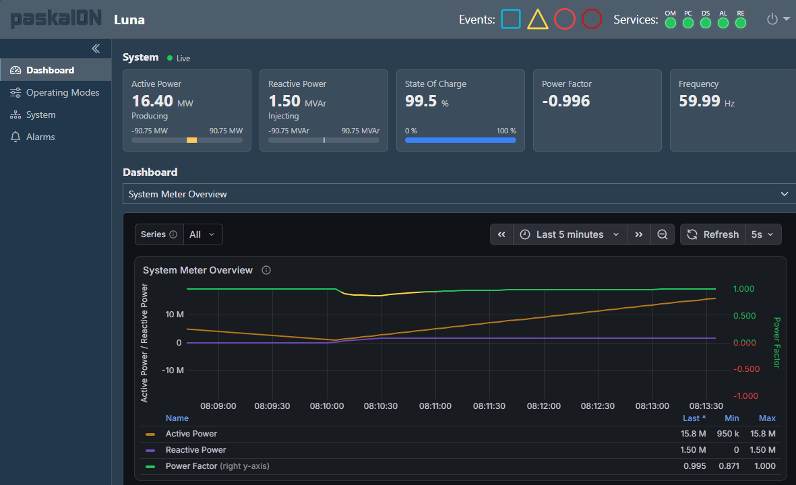
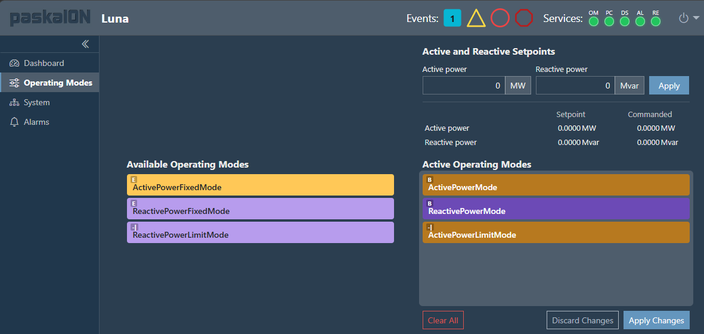
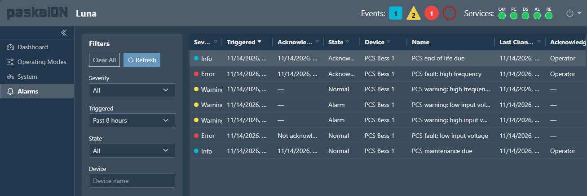
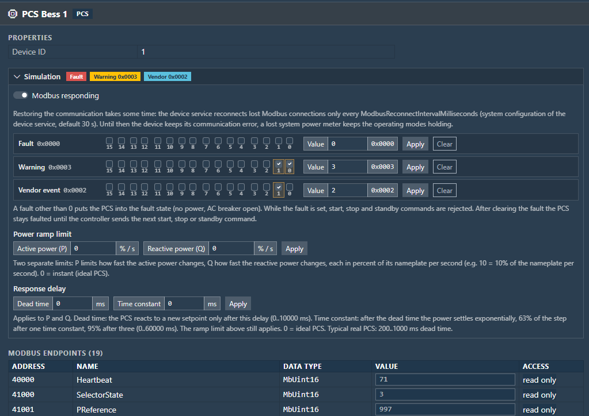
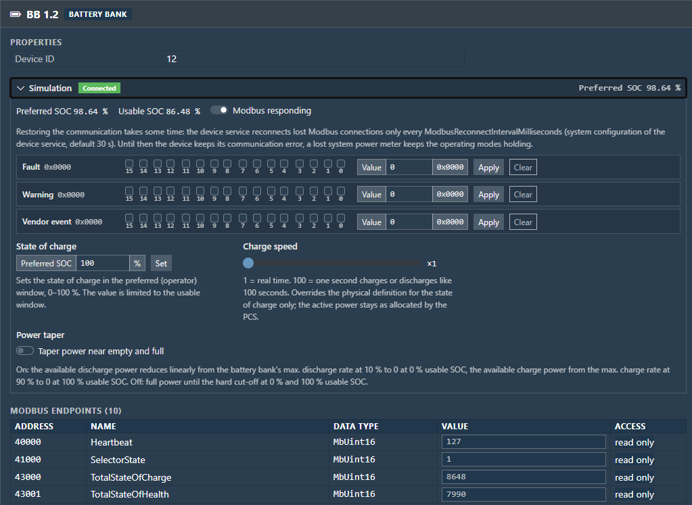
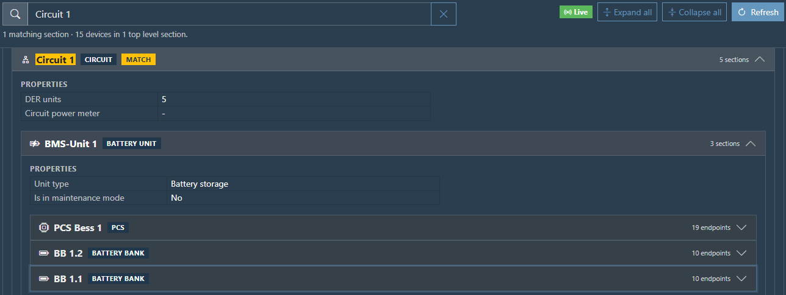

# Product Spotlight: paskalON Power Plant Control

## Control it live. Prove it virtually.

A power plant earns money only when its controller does exactly what the grid asks, and you can show that it did. paskalON delivers two products built as a pair: one runs your plant, the other proves your control logic before you energize a single device.

---

## PPC Controller: your plant on one screen

- **Real-time dashboard.** Active and reactive power, state of charge, power factor and frequency, live. Below them, switch between multiple dashboards with one click, each built for a different view of the plant. You see what the plant is doing *now*.
- **Operating modes with active feedback.** Stack the modes, enter a setpoint, apply. The controller shows what you **requested**, what it **commanded**, and **when a limit took over**, so you never have to guess.
- **Event handling with acknowledge history.** Every warning and fault is captured and can be filtered. Operators acknowledge with one click, and the history records who acknowledged what and when.
- **Built to keep running.** The Controller runs as independent microservices, each with its own job and its own data. If one service drops out, the plant holds its last setpoint and resumes automatically when the service returns. You can update or restart a single service without touching the rest, and the live service status in the header shows where to look when something goes wrong. The architecture is also ready for redundant, failover deployments as your plant grows.

---

## PPC Simulator: your whole plant, virtual

- **Device simulation.** Every inverter, battery bank and meter speaks the real protocol and behaves like the real device: Modbus for inverters and battery banks, Modbus or IEEE C37.118 synchrophasor for meters. Inject faults or cut communication, then watch your controller react.
  - **PCS:** add active and reactive power ramp limits and a realistic response delay.
  - **Battery bank:** set the state of charge, speed up charging 100× and taper the power near empty and full.
- **Device filtering.** Groups, circuits, units and devices sit in one live tree. Type a name and you find any device in seconds, even in a plant with 70+ devices.

---

**See it live.** Contact paskalON for a demo and put your next plant through its paces.
